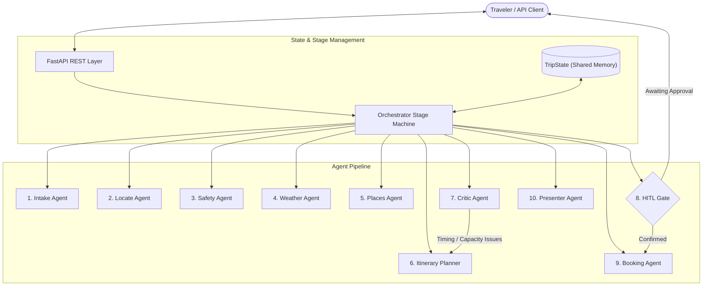

# 🌍 Trip Planner Multi-Agent System

[](https://www.python.org/downloads/)
[](https://fastapi.tiangolo.com)
[](https://docs.pydantic.dev/)
[]()
[]()

> **A production-ready, stateful multi-agent trip planning engine.** Combines deterministic spatial math, safety gates, structured LLM self-repair, human-in-the-loop booking checkpoints, and an automated evaluation framework.

---

## 📖 Overview

Planning a trip with standard LLM prompts often leads to hallucinations: overlapping schedules, impossible travel distances, invented attractions, or premature financial bookings.

**Trip Planner** solves this by adopting a **defensive, state-graph multi-agent architecture**. It separates free-form language understanding from pure mathematical planning, validates every schedule through deterministic arithmetic criticism, and enforces a mandatory **Human-in-the-Loop (HITL)** approval gate before taking real-world booking actions.

---

## ✨ What Makes It Unique?

### 1. 🛡️ Deterministic Criticism (Zero LLM Self-Grading)
* **The Problem**: LLMs are notoriously bad at grading their own work and will happily approve an itinerary where a traveler teleports across a city in 0 minutes.
* **Our Solution**: The **Critic Agent** runs **pure Python arithmetic**:
  - **Haversine Distance**: Calculates real travel distance between stops.
  - **Transit Speed & Overhead**: Enforces $20\text{ km/h}$ city speed plus a mandatory $10\text{ min}$ transfer overhead.
  - **Curfew & Working Limits**: Rejects schedules that end after 22:00 (10 PM) or exceed $600\text{ min}$ (10 hours) of daily activity.
  - **Daily Stop Capacity**: Caps stops at 4 for full days and 2 for arrival/departure edge days.

### 2. 🤝 Human-in-the-Loop (HITL) Booking Safety
* Inspired by the LangGraph Human-in-the-Loop architecture, financial and irreversible operations are never executed autonomously.
* When the user requests a booking, the system generates and validates the entire itinerary first, then **pauses execution in `Stage.NEEDS_INPUT`**.
* The traveler must explicitly approve the plan:
  - **Via Chat**: *"Yes, proceed with booking"* / *"No, don't book"*.
  - **Via REST API**: `POST /trips/{trip_id}/confirm-booking` with `{"confirm": true}`.
* Only upon explicit approval does the **Booking Agent** execute the reservations (with `attempts=1` to prevent duplicate charges).

### 3. 📊 Built-In LLM Evaluation Framework
* Implements the **LLM Application Evaluation Rubric** (inspired by the [`llm-evaluation`](https://github.com/wshobson/agents) skill):
  - **Constraint Satisfaction Score**: Percentage of days passing arithmetic feasibility checks ($1.0 = 100\%$).
  - **Interest Coverage Score**: Quantifies how well user interests match scheduled activity notes and themes.
  - **Safety Adherence Score**: Verifies risk thresholds and ensures high-hazard regions halt the pipeline.
  - **Coherence Score**: Checks sequential day numbering ($1 \dots N$) and guarantees zero duplicate places.
  - **LLM-as-a-Judge**: Evaluates Accuracy, Coherence, Relevance, Fluency, and Safety on a 1–5 rubric.
  - Queryable anytime via `GET /trips/{trip_id}/evaluate`.

### 4. 🔄 In-Flight Self-Repair Protocol
* If an agent emits invalid JSON or violates domain constraints (e.g., a start date in the past or unknown place IDs), the raw error is automatically fed back to the LLM for a **1-step self-repair attempt** before raising an error.

### 5. 🎯 Bayesian Place Scoring & Spatial Clustering
* **Bayesian Rating**: Uses a prior mean rating ($4.2$) and confidence threshold ($200\text{ reviews}$) so a $5.0$-star spot with 10 reviews cannot beat a $4.8$-star landmark with 4,000 reviews.
* **Geographic Proximity**: Groups nearby places into the same day using Haversine clustering to minimize zigzagging across towns.

---

## 🏛️ System Architecture



### Complete Agent Roster

| # | Agent | File | Primary Responsibility |
|---|---|---|---|
| 1 | **Intake Agent** | [`app/agents/intake.py`](app/agents/intake.py) | Parses traveler messages into structured `TripRequest`. Rejects past dates; pauses cleanly on missing input (`NeedsInput`). |
| 2 | **Locate Agent** | [`app/agents/locate.py`](app/agents/locate.py) | Geocodes destination into latitude/longitude (`GeoPoint`). |
| 3 | **Safety Agent** | [`app/agents/safety.py`](app/agents/safety.py) | Scans USGS/GDACS feeds. **Safety Gate**: Immediately halts downstream planning if risk is `"avoid"`. |
| 4 | **Weather Agent** | [`app/agents/weather.py`](app/agents/weather.py) | Fetches daily forecast. Degrades gracefully with warnings if external API is unreachable. |
| 5 | **Places Agent** | [`app/agents/places.py`](app/agents/places.py) | Discovers candidate attractions and dining around coordinates. |
| 6 | **Scoring Agent** | [`app/planning.py`](app/planning.py) | Bayesian review-weighted ranking and spatial proximity sorting. |
| 7 | **Itinerary Planner** | [`app/agents/itinerary.py`](app/agents/itinerary.py) | Assembles daily themes, stops, and durations matching traveler preferences. |
| 8 | **Critic Agent** | [`app/agents/critic.py`](app/agents/critic.py) | Deterministic arithmetic validator. Checks travel gaps, max busy time, and curfews. |
| 9 | **Repair Agent** | [`app/agents/repair.py`](app/agents/repair.py) | Applies targeted schedule adjustments when the critic identifies issues. |
| 10 | **Booking Agent** | [`app/agents/booking.py`](app/agents/booking.py) | Prepares lodging and transport reservations. Runs only after human approval. |
| 11 | **Presenter Agent** | [`app/agents/presenter.py`](app/agents/presenter.py) | Renders a polished, traveler-ready Markdown summary with safety notes and weather. |

---

## 📂 Project Structure

```text
trip_planner/
├── app/
│   ├── agents/               # 10 Specialized Multi-Agent implementations
│   │   ├── base.py           # Protocol definitions & clocks
│   │   ├── intake.py         # Request parsing & input validation
│   │   ├── locate.py         # Geocoding agent
│   │   ├── safety.py         # Risk analysis & hazard alerts
│   │   ├── weather.py        # Forecast retrieval
│   │   ├── places.py         # Candidate search
│   │   ├── scoring.py        # Bayesian place scoring
│   │   ├── itinerary.py      # Day-by-day plan assembler
│   │   ├── validator.py      # Validation interface
│   │   ├── critic.py         # Deterministic schedule audit
│   │   ├── repair.py         # Focused itinerary repair
│   │   ├── booking.py        # Idempotent reservation handler
│   │   └── presenter.py      # Markdown itinerary synthesizer
│   ├── adapters.py           # HTTP external adapters (Google Places, Open-Meteo, etc.)
│   ├── bootstrap.py          # Composition root & dependency wiring
│   ├── config.py             # Environment & settings configuration
│   ├── docs.py               # Dynamic documentation provider (langgraph-docs pattern)
│   ├── errors.py             # Domain exceptions (NeedsInput, RetryableError)
│   ├── evaluation.py         # LLM evaluation metrics & LLM-as-a-Judge
│   ├── http.py               # Robust HTTP client wrapper with retries
│   ├── llm.py                # LLM protocol, Ollama adapter, & self-repair engine
│   ├── main.py               # FastAPI REST application routes
│   ├── models.py             # Pydantic v2 schemas & TripState shared memory
│   ├── orchestrator.py       # Deterministic stage machine with execution tracing
│   ├── planning.py           # Pure mathematical algorithms (Haversine, Clustering, Feasibility)
│   ├── ports.py              # Interface protocols for external services
│   └── prompts.py            # Strictly grounded agent system prompts
├── tests/
│   ├── fakes.py              # Mock backends and scripted LLM test doubles
│   ├── test_api.py           # FastAPI endpoint tests
│   ├── test_core_parts.py    # Unit tests for core requirements
│   ├── test_docs.py          # DocsProvider tests
│   ├── test_evaluation.py    # Evaluation metric tests
│   ├── test_orchestrator.py  # Orchestrator & HITL tests
│   └── test_planning.py      # Spatial & arithmetic planning tests
├── pytest.ini                # Pytest configuration
├── requirements.txt          # Python dependencies
└── README.md
```

---

## 🚀 Getting Started

### Prerequisites
* Python 3.12+
* [Ollama](https://ollama.ai) (optional for local inference; defaults to `llama3.1:8b`)
* Google Places API Key

### 1. Installation

```bash
git clone https://github.com/varunsivasamy/trip_pallaner_agent.git
cd trip_pallaner_agent

python -m venv .venv
source .venv/bin/activate  # On Windows: .venv\Scripts\activate

pip install -r requirements.txt
```

### 2. Environment Configuration

Set the following environment variables (or create a `.env` file):

```bash
export GOOGLE_PLACES_API_KEY="your_google_places_api_key"
export OLLAMA_URL="http://localhost:11434"
export OLLAMA_MODEL="llama3.1:8b"
export HTTP_TIMEOUT_S="120"
```

### 3. Running the Server

```bash
uvicorn app.main:app --reload --port 8000
```
API Documentation will be live at:
* Swagger UI: [http://localhost:8000/docs](http://localhost:8000/docs)
* ReDoc: [http://localhost:8000/redoc](http://localhost:8000/redoc)

---

## 📡 API Reference

### 1. Create a Trip
```http
POST /trips
Content-Type: application/json

{
  "message": "Plan a 2-day trip to Munnar from Coimbatore starting 2026-11-10 with tea garden visits and book it"
}
```

### 2. Follow-Up Message / Answering Questions
```http
POST /trips/{trip_id}/messages
Content-Type: application/json

{
  "message": "Yes, please go ahead and confirm the booking"
}
```

### 3. Human-in-the-Loop Booking Confirmation
```http
POST /trips/{trip_id}/confirm-booking
Content-Type: application/json

{
  "confirm": true
}
```

### 4. Fetch Trip State
```http
GET /trips/{trip_id}
```

### 5. Evaluate Trip Quality
```http
GET /trips/{trip_id}/evaluate
```
**Sample Evaluation Output:**
```json
{
  "trip_id": "4b6d05f333ec4d57816df98967b5d19a",
  "overall_score": 0.95,
  "automated_metrics": [
    {
      "name": "Constraint Satisfaction",
      "score": 1.0,
      "passed": true,
      "details": "All day schedules meet feasibility constraints."
    },
    {
      "name": "Interest Coverage",
      "score": 1.0,
      "passed": true,
      "details": "Matched 1 of 1 interests: tea gardens"
    },
    {
      "name": "Safety Adherence",
      "score": 1.0,
      "passed": true,
      "details": "Safety risk level: low, recommendation: proceed"
    },
    {
      "name": "Coherence",
      "score": 1.0,
      "passed": true,
      "details": "Sequential day numbering and unique place visits verified."
    }
  ],
  "execution_steps": 8,
  "issues": []
}
```

---

## 🧪 Testing

The repository features comprehensive unit and integration test coverage:

```bash
python -m pytest
```

Output:
```text
======================== 35 passed, 1 warning in 5.01s ========================
```

---

## 📄 License

Distributed under the MIT License. Feel free to fork, customize, and extend!
